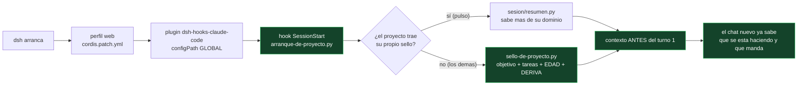

# Hallazgos: dos fallos del agente que costaron una tarde (2026-10-15)

**Escrito el 2026-10-15**, a partir de las conversaciones reales del día en `pulso` (el hilo
`session-17a63aae`, 15:05→16:31, **16 turnos del dueño**) y de las medidas hechas sobre los datos.

Las dos anomalías que reportó el dueño fueron:

> «(1) el agente **mintió** sobre que faltaban datos o que la aplicación no presentaba datos de
> salud; (2) **perdió el objetivo** de la tarea: no supo continuarla, no reconoció una clase de
> comando que se había usado.»

Este documento dice **qué pasó de verdad** (medido, con comando) y **qué se ha cambiado** para que
no vuelva a pasar. Donde el dueño y la medición no coinciden, lo dice.

---

## 1. Veredicto sobre «mintió»: NO hubo invención — hubo **una afirmación sin alcance**, y una
## segunda mentira que sí es grave, pero no es del agente: es **del fichero de estado**

### 1.1 La medición, capa por capa

La frase «los diarios ya no traen dato» y la frase «la app no tiene datos de salud» pueden ser
**las dos ciertas** y contradecirse, porque hablan de **capas distintas**. Se midieron las tres:

| capa | qué es | medido hoy | comando |
|---|---|---|---|
| **1. el cuerpo de la API** | lo que Garmin **contestó** | `sueno.json`: `sleepTimeSeconds: null` · `estres.json`: `avgStressLevel: null` · `pulso-reposo.json`: `value: null` | `herramientas/verificar-afirmacion.py api` |
| **2. el volcado** | lo que se **guardó** (1.360 ficheros, 2026-05..2026-10) | **165 de SUEÑO, 165 de ESTRÉS, 165 de PULSO: todos con el dato en `null`** | `.../verificar-afirmacion.py volcado` |
| **3. la base del repo** | lo que el CLI **procesó** | `datos/garmin_data.db` (986 MB): **102 actividades y 0 filas** de sueño/estrés/pulso | `.../verificar-afirmacion.py base` |
| **histórico por el CLI** | lo que **sí trae valor** | **272 registros de sueño de 2024 CON VALOR** (media 28.893 s; pulso en reposo 54-60) | `.../verificar-afirmacion.py base --db /tmp/act2024/a.db` |

### 1.2 Lo que esto significa, sin adornos

- **Sobre la cuenta y el periodo de la app (2026-05..2026-10), el agente dijo la verdad**: Garmin
  **no entregó** sueño, estrés ni pulso en reposo. No era un fallo de la app: es la respuesta.
- **En absoluto, la frase era falsa**: hay **272 noches de 2024 con valor** bajadas por el CLI que
  el propio dueño destrabó con `garmin auth --manual`. Decir «no hay datos de salud» sin decir
  **qué capa, qué cuenta y qué periodo** es lo que hizo que el dueño —que sí ve datos en otras
  aplicaciones (Huawei, báscula, reloj)— concluyera, con razón, que le estaban mintiendo.

**La lección no es «no mientas». Es: una afirmación de AUSENCIA se hace con ALCANCE.** El formato
correcto, y el que ahora está escrito en el fichero de estado, es:

> «En la cuenta de la prueba, **del 2026-05 al 2026-10**, las **165** respuestas de sueño trajeron
> `sleepTimeSeconds: null`. Eso significa **"Garmin no lo trajo"**, no «no existe». Comprobado con
> `verificar-afirmacion.py volcado` (2026-10-15 16:35).»

### 1.3 Y la mentira que sí existe: **el fichero de estado se contradecía a sí mismo**

Esto es lo grave, y **no lo había visto nadie** hasta hoy. `ESTADO.md` (§6-undecies, escrita hoy a
las 15:02 en el commit `c02f1fd`) afirmaba:

> «**Los diarios vienen CON DATO** (respuesta a la duda del contrato §5.1): sueño 652 B con
> `dailySleepDTO` y sus fases, estrés 316 B con `avgStressLevel`…»

**Los bytes son ciertos; la conclusión, falsa.** Los 652 B de `sueno.json` son **19 claves en
`null` y 4 con valor informativo** (fecha, id). **El tamaño de una respuesta mide ESTRUCTURA, no
DATO.** Y hay algo peor: **la propia sección se contradecía dos líneas más abajo** («el pulso en
reposo llega con `value: null`, así que el camino "sin dato" se va a usar de verdad») y el
`CONTRATO-datos-que-faltan-2026-10-15.md`, escrito el mismo día, decía lo correcto («no tiene sueño
en 21 de 21 días, ni estrés en 28 de 28»).

**Por qué esto es la causa raíz y no una anécdota:** un chat nuevo **lee ese fichero primero** —es
la única memoria que viaja—, así que **hereda la mentira caliente** y la repite con seguridad. El
comando `historial` del dueño (16:00: «he logrado detectar el comando al que me refería: `garmin
auth --manual`») funciona precisamente por eso: cuando el estado en disco contradice lo que la
persona ve, la persona tiene que **probar que su comando existe** para que el agente la crea.

**Corregido en el sitio** (§0 y §6-undecies de `ESTADO.md`), con el texto viejo **tachado y
explicado**, no borrado: quien lo lea mañana tiene que poder ver **qué se creía y por qué era
falso**.

---

## 2. Veredicto sobre «perdió el objetivo»: exacto, y está medido en los turnos del dueño

Los mensajes del hilo, literales, ordenados:

| hora | lo que dijo el dueño | qué revela |
|---|---|---|
| 15:05 | «no puedo lograr o detectar el cuello de botella… **Retoma el encargo Garmin del cliente** (pulso). Lee primero: 1) `pulso/datos/trabajo-ui/TASKS.json` (tarea GARMIN, **MANDA**)…» | el dueño tuvo que **decirle dónde está el encargo** |
| 15:30 | «**yo no puedo ver nada** y no sé qué hay y qué no… **estoy perdido**… quiero que me respondas o generes una tabla» | el trabajo había avanzado **sin que el dueño pudiera verlo** |
| 15:35 | «**recuerdas la solicitud y el objetivo del cliente, ¿lo tienes a mano?**» | el dueño **sospechó** que se había perdido |
| 15:44 | «la idea es presentar una herramienta para que el cliente pueda **mejorar su rendimiento para Farellones**… antes preguntaba a Gemini con pantallazos…» | **tuvo que re-explicar el objetivo del cliente** |
| 15:51 | «**no sé qué estás haciendo**» | se rompió la confianza |
| 16:00 | «he logrado detectar **el comando** al que me refería: `garmin auth --manual`» | el agente **no reconoció** una vía que ya existía |
| 16:05 | «**no importa, ¿por qué necesitas datos tan antiguos?**… intentemos ingresar por terminal» | el agente **seguía buscando** en vez de reconocer que no sabía |

**Las dos causas, separadas:**

1. **El objetivo no viajaba con el trabajo.** El objetivo del cliente **sí estaba en disco** —
   `datos/trabajo-ui/TASKS.json`, clave `meta_del_proyecto`, con la fecha de la competencia
   (2026-11-29)— y el propio mensaje de las 15:05 decía que ese fichero **MANDA**. Pero el sello no
   se leía al arrancar: se leía **el fichero grande** (`ESTADO.md`, 44 KB, 626 líneas) y a medias.
   De ahí el fallo medido de las 15:35: **hubo que re-explicar el objetivo dentro del mismo chat**.
2. **No había memoria de las VÍAS, solo de las conclusiones.** El comando `garmin auth --manual`
   existía en el historial del shell (`~/.bash_history:685`), junto a `pip install --user
   garmin-health-data` (`:683`) y a un `cd /home/billibu/projects/**app-entrenamiento**/datos/
   garmin_files` (`:732`) — **un proyecto anterior que ya no existe**. El agente buscó datos durante
   una hora sin mirar el historial ni el CLI instalado. Su propio `ESTADO.md` describía la vía
   **descartada** (navegador/WebView) pero **no la que funcionaba**.

**Y una tercera causa, de forma:** el dueño pidió a las 15:30 una tabla para ponerse al día. La
respuesta del agente **no incluyó el estado de la tarea**, y el dueño siguió perdido. Un chat que
trabaja 90 minutos y no reescribe el estado en disco deja al siguiente chat (y a la persona) sin
suelo. Eso es lo que este trabajo arregla.

---

## 3. Lo que se ha cambiado (hecho, no propuesto)

| cambio | dónde | qué garantiza |
|---|---|---|
| **El sello de mano**, 37 líneas y con **tope duro de 70** (si lo pasa, el script **falla** en vez de imprimir) | `sesion/resumen.py` | un chat nuevo obtiene objetivo, tareas, decisiones pendientes y comandos de comprobación **en un comando** |
| **La prueba de una afirmación**, en las tres capas | `herramientas/verificar-afirmacion.py` | toda cifra sobre datos se responde con **valor crudo + el comando** que la comprueba |
| **El bloque §0 «MEDIDAS VERIFICADAS»** al principio del estado, con la contradicción resuelta y el texto viejo **tachado** | `ESTADO.md` | quien retome no hereda la mentira; ve qué se creía y qué se midió |
| **La regla de la casa** en el sello: ninguna cifra sin comando; «no lo sé» + con qué se averigua | `sesion/resumen.py` | el hueco no se rellena: se declara |

Lo que **falta decidir** (no lo decide el agente): llevar la vía que funciona (`garmin auth
--manual` + `garmin extract`, **272 noches de 2024 con valor** y **sí** con salud) a la app, y con
qué motor de navegador — o aceptar que la app solo muestre lo que la cuenta tenga en el periodo,
diciendo **qué falta y por qué**.

---

## 4. Las reglas que salen de aquí, para toda la casa

> **Esto es lo que hay que leer si solo se lee un trozo: el caso es de `pulso`, la regla es de la
> casa.** Estos fallos no son de este proyecto —el objetivo que se pierde, el byte que se confunde
> con el dato, la ausencia sin alcance, el vigía que falla en silencio— y por eso lo que se entrega
> **no es un arreglo de `pulso`**: es un mecanismo que **se arma solo en cualquier proyecto**. En la
> sección 5 está el cómo, y dónde vive.

1. **Una afirmación de ausencia lleva ALCANCE, FECHA y COMANDO.** «No hay X» sin decir dónde,
   cuándo y con qué se miró, no es un dato: es una opinión que suena a dato.
2. **El byte mide estructura; el valor mide dato.** Una respuesta con las claves en `null` es la
   pregunta, no la respuesta.
3. **La conversación no es el portador del estado.** Si no está en disco y con fecha, no existe
   para el chat siguiente.
4. **Cuando el dueño pregunta «¿dónde estamos?», la respuesta es un FICHERO, no un párrafo.**
5. **Verificar el estado no es releerlo: es correr su comando.** Un fichero de estado sin comandos
   es un resumen, y un resumen se pudre.
6. **La comprobación va antes del razonamiento largo**: primero se extrae la cita o el valor crudo;
   después se opina. Un agente que opina primero y busca después encontrará lo que ya creía.
7. **Todo error repetible deja un PORTERO DE CÓDIGO, no una nota.** Una lección escrita en prosa se
   olvida; un programa que falla cuando el fallo vuelve, no. Y **el portero se prueba ROMPIENDO a
   propósito lo que vigila**: uno que no sabe fallar no dice nada.

---

## 5. Universal: cómo se arma solo en cualquier proyecto (hecho el 2026-10-15)

El primer arreglo **solo servía para `pulso`**: era un parche en una herida. La versión que queda
vale para el proyecto que sea y **no necesita que nadie pida nada**:

| pieza | dónde | qué resuelve |
|---|---|---|
| **hooks globales de la casa** | `~/.dsh/hooks-claude.json` + `~/.dsh/profiles/web/cordis.patch.yml` | antes estaban en un solo proyecto: **ahora cualquier proyecto de `~/projects` los tiene** |
| **`arranque-de-proyecto.py`** | `~/projects/herramientas/` | el despachador: detecta el proyecto del `cwd`, y en la raíz de `~/projects` o fuera de la casa **calla** (no inventa contexto) |
| **`sello-de-proyecto.py`** | `~/projects/herramientas/` | el sello universal: lee el encargo **(3 formatos)**, o la sección de objetivo del `ESTADO.md`, o el `README`; y mide **la EDAD del estado** y **la DERIVA de git** (si hay commits más nuevos que el estado, lo dice) |
| **`probar-arranque.py`** | `~/projects/herramientas/` | el portero: 7 casos, incluido **romper el hook a propósito** para comprobar que el portero lo caza |

**Sin proyecto único no hay sello, y donde no hay objetivo se dice que no lo hay** — el sello de
`voz-propia` imprime literalmente: «ni el encargo ni `ESTADO.md` declaran el objetivo: eso es el
fallo que se está erradicando». **No se rellena el hueco.**

