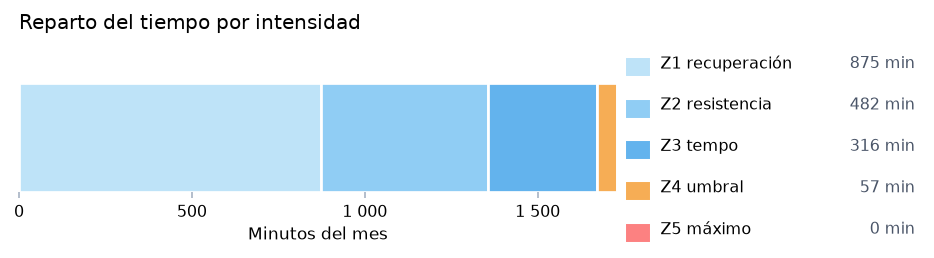
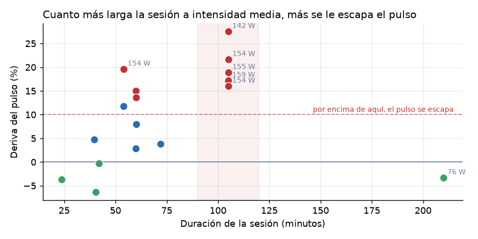
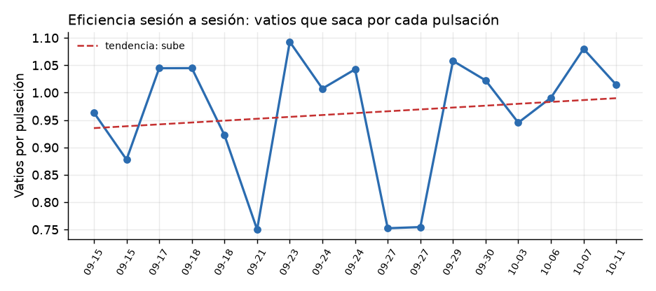

# Lo esencial, en una página

Se han analizado **21 sesiones de entrenamiento** realizadas entre el **13 de septiembre y el 11 de
octubre**, con un total de **29 horas** y algo más de **un millón trescientas mil mediciones** de pulso,
potencia y cadencia, tomadas una por segundo.

De ese análisis salen **tres conclusiones**. Dos son buenas, y una conviene corregirla.

::: aviso
**Primera: sus zonas de entrenamiento están mal calibradas, y llevan un mes siéndolo.**

Las zonas con las que entrena se construyeron sobre una **estimación** de su frecuencia cardíaca máxima
a partir de su edad, que da **166 pulsaciones**. Pero en sus propios entrenamientos hay registros de
hasta **179**, y su perfil de Garmin declara un **umbral de lactato de 169**.

Es decir: **su corazón da más de lo que sus zonas dicen.** Y eso tiene una consecuencia concreta y fácil
de entender: **cuando usted cree que entrena en un nivel, en realidad está entrenando en el de
abajo.** Todo su mapa de intensidades está desplazado hacia abajo.
:::

::: aviso
**Segunda: aguanta bien hasta una hora. A partir de la hora y media, a intensidad media, se le escapa el
pulso.**

Está medido en las cinco sesiones de 105 minutos, y las cinco se comportan igual. **Ese es su punto a
trabajar**, y no es ni el más suave ni el más fuerte: es el intermedio.
:::

::: aviso
**Tercera: su motor aeróbico es excelente.**

Con un consumo máximo de oxígeno de **57**, está en un nivel propio de un deportista, no de una persona
de su edad. Y cuando entrena suave, **aguanta lo que le echen**: en la salida de tres horas y media el
pulso se le quedó **por debajo** de lo esperado, que es justo lo que se busca.
:::

# Qué se ha analizado

## De dónde salen los datos

De su cuenta de Garmin, a la que se ha accedido con su autorización. Concretamente:

| qué | cuánto |
|---|---|
| **sesiones** | **21**, del 13 de septiembre al 11 de octubre |
| **tiempo total** | **29 horas** |
| **mediciones** | **más de 1 300 000**, una por segundo |
| **medidores** | pulso, potencia, cadencia, temperatura y posición |

**La potencia se mide con dos medidores independientes** (uno en cada pedal), lo que permite un análisis
más fino que el que se hace solo con el pulso. Esto es una ventaja real: **el pulso tarda en subir,
mientras que la potencia refleja el esfuerzo en el instante mismo.**

## Sus datos de referencia

| dato | valor | de dónde sale |
|---|---|---|
| **edad** | 60 años | su perfil |
| **peso** | 68 kg | su perfil |
| **altura** | 178 cm | su perfil |
| **consumo máximo de oxígeno** | **57** | estimado por Garmin |
| **umbral de lactato** | **169 pulsaciones** | declarado en su perfil |
| **frecuencia máxima observada** | **179 pulsaciones** | registrada el 15 de septiembre |

# Los tres hallazgos

## Hallazgo primero: sus zonas están desplazadas

En ciclismo, las zonas de entrenamiento **no se fijan sobre la frecuencia máxima, sino sobre el umbral
de lactato** — el punto en el que el esfuerzo empieza a acumularse más rápido de lo que el cuerpo
elimina. Es un dato **medido**, y por tanto mucho más fiable que cualquier estimación.

**Usted tiene ese dato declarado: 169 pulsaciones.** Y sus zonas se construyeron, en cambio, sobre una
estimación por edad que da 166, que además **se queda corta para una persona entrenada**, porque la
fórmula está pensada para la media de la población y no para un deportista.

**Comparación de las dos formas de fijar las zonas:**

| zona | con la estimación de 166 | con su umbral de 169 |
|---|---:|---:|
| **Z1** recuperación | hasta 130 | **hasta 137** |
| **Z2** resistencia | 130-143 | **137-152** |
| **Z3** tempo | 143-152 | **152-159** |
| **Z4** umbral | 152-162 | **159-169** |
| **Z5** consumo máximo | 162-166 | **169-203** |

: Comparación de las zonas según la estimación por edad y según el umbral de lactato real.

::: norma
**Lo que esto significa en la práctica, y es lo importante:**

**Su zona de umbral —la que sirve para mejorar la resistencia— empieza en 159 pulsaciones, no en 152.**
Y su zona de tempo, **en 152, no en 143**.

**Consecuencia directa**: esas sesiones de 105 minutos que usted hacía con el pulso entre 134 y 147
—y que sus zonas le presentaban como trabajo de umbral— **en realidad estaban en resistencia y tempo**.
Es decir: **ha estado entrenando por debajo de lo que creía**, y precisamente en la franja que el
segundo hallazgo señala como su punto débil.
:::

## Hallazgo segundo: el límite aparece a partir de la hora y media

Aquí está el análisis más útil de todos, y se entiende sin tecnicismos.

**Qué se ha medido**: en cada sesión se ha comparado **la primera mitad con la segunda**. Si en la
segunda mitad **el pulso sube mientras la potencia baja**, significa que el cuerpo está trabajando más
de lo que el rendimiento refleja: se está cansando. Esa diferencia se llama **deriva**, y se mide en
porcentaje.

**El resultado, agrupado por duración:**

| duración de la sesión | sesiones | deriva | potencia media |
|---|---:|---:|---:|
| **hasta 60 minutos** | 10 | **+6,5 %** | 116 W |
| **de 60 a 120 minutos** | 6 | **+17,5 %** | **147 W** |
| **más de 120 minutos** | 1 | **−3,4 %** | 76 W |

: La deriva del pulso según la duración de la sesión.

**Y las cinco sesiones de 105 minutos, una a una:**

| fecha | potencia media | deriva |
|---|---:|---:|
| 15 de septiembre | 142 W | **+27,5 %** |
| 3 de octubre | 154 W | **+21,6 %** |
| 18 de septiembre | 155 W | **+18,8 %** |
| 29 de septiembre | 159 W | **+17,2 %** |
| 11 de octubre | 154 W | **+16,0 %** |

: Las cinco sesiones de 105 minutos, ordenadas por deriva.

::: aviso
**Lo que dicen estos números:**

- **Hasta una hora, aguanta bien** (+6,5 %). Su respuesta al esfuerzo es sólida.
- **A partir de unos 90 minutos a 150 vatios, el pulso se le escapa y la potencia cae** (+17 %). **Ahí
  está su límite**, y es el mismo en las cinco sesiones: no es un mal día, es un patrón.
- **Y cuando va suave, aguanta lo que le echen**: en la salida de **210 minutos a 76 vatios** la deriva
  fue **negativa (−3,4 %)** — el pulso se quedó **por debajo** de lo esperado. Eso es exactamente lo
  que se busca en un trabajo de fondo.
:::

## Hallazgo tercero: su base aeróbica es excelente

**Un consumo máximo de oxígeno de 57** en un hombre de 60 años está **muy por encima de lo habitual**:
es un valor de deportista entrenado, no de una persona de su edad.

**Y se confirma con el resto de los datos**: en un mes ha acumulado **29 horas de entrenamiento**,
incluyendo **tres salidas de montaña de más de tres horas y media**, con una respuesta cardiovascular
que aguanta sin problemas cuando el ritmo es suave.

**Traducción**: **no le falta base. Le falta el trabajo del medio.**

## El reparto del mes, y dónde está el hueco

| zona | minutos | proporción |
|---|---:|---:|
| **Z1** recuperación | 875 | **51 %** |
| **Z2** resistencia | 482 | 28 % |
| **Z3** tempo | 316 | 18 % |
| **Z4** umbral | 57 | **3 %** |
| **Z5** consumo máximo | **0** | **0 %** |

: Distribución del tiempo de entrenamiento por zona, según Garmin.

**Casi ocho de cada diez minutos son de intensidad baja**, y el trabajo de umbral es prácticamente
testimonial. **Y hay cero minutos en la zona más alta en todo un mes.**

**Juntando esto con el segundo hallazgo, el cuadro es coherente**: usted **entrena mucho y bien en
suave**, tiene una **base excelente** por eso mismo, y **falla justo en la franja intermedia** — porque
es la franja que apenas trabaja.

::: norma
**Y aquí conviene ser preciso**: este reparto está calculado con las zonas antiguas, las de la
estimación. **Con las zonas corregidas, el reparto cambia**, y una parte de lo que hoy figura como
trabajo de umbral pasará a ser tempo, y parte del tempo, resistencia. **El desequilibrio sigue ahí, pero
el punto exacto donde empujar está unos diez latidos más arriba de lo que indican estos números.**
:::

# Qué conviene hacer con esto

**Estas son las conclusiones del análisis, no una prescripción médica.** Cualquier cambio importante de
intensidad, a los 60 años y con entrenamiento competitivo, **conviene hablarlo con quien le sigue la
salud**.

**Primero, corregir las zonas.** Es lo más urgente porque **todo lo demás depende de ello**: mientras las
zonas estén bajas, cualquier trabajo por intensidad se hará en el sitio equivocado. **Con su umbral de
169, el punto de trabajo correcto está diez latidos por encima de donde ha estado.**

**Segundo, trabajar la franja intermedia.** El análisis señala un límite claro: **a partir de los 90
minutos a 150 vatios, el pulso se escapa**. Ese es el punto exacto que hay que empujar, y no se arregla
ni entrenando más suave —que ya lo hace mucho— ni añadiendo series explosivas.

**Tercero, y es una buena noticia que conviene no estropear**: **su base aeróbica es su fuerte**. Las
salidas largas a ritmo suave funcionan y debe conservarlas. **El objetivo no es cambiarlas, sino añadir
lo que falta sin quitar lo que funciona.**

# Lo que este análisis no puede decir todavía

**Un mes es una fotografía, no una película.** Con estos datos se pueden comparar unas sesiones con
otras, y eso ya ha dado los tres hallazgos de arriba. Pero hay dos cosas que **todavía no se pueden
afirmar**, y conviene decirlo con claridad en lugar de rellenarlo con suposiciones.

**La primera: si está mejorando o mantenido.** La mejora es una **tendencia**, y una tendencia necesita
**dos momentos separados en el tiempo**. Con un solo mes, lo que hay es el punto de partida. **En cuanto
haya un segundo mes, la comparación es directa**: se verá si hace el mismo trabajo con menos pulso, que
es la forma más limpia de medir si el entrenamiento está funcionando.

**La segunda: qué papel juegan el sueño y la alimentación.** Usted mismo ha señalado que su progreso
sale de **combinar entrenamiento, descanso y alimentación** — y tiene razón. Pero **esos datos no están
en Garmin**: el aparato que usa registra el ejercicio, no el día entero. **No hay registro de sueño, ni
de pulso en reposo, ni de alimentación.**

**Para incorporarlos no hace falta ningún aparato nuevo.** Bastan **cuatro datos cortos** alrededor de
cada sesión:

| dato | cómo se responde |
|---|---|
| **horas de sueño** | un número |
| **cómo se sintió** | una marca del 1 al 5 |
| **qué comió antes de entrenar** | una de cuatro opciones |
| **si tomó alcohol** | sí o no |

**Son cuatro respuestas que llevan menos de un minuto**, y son justamente las que hoy se pierden: usted
las tiene en la cabeza al interpretar sus datos, pero **no quedan registradas, y por tanto no se pueden
comparar con las de la semana pasada**.

# Resumen

| conclusión | estado |
|---|---|
| **Sus zonas están unos diez latidos por debajo de lo que le corresponde** | **corregir** |
| **Aguanta bien hasta una hora; a partir de 90 minutos a 150 W se le escapa el pulso** | **trabajar ahí** |
| **Su base aeróbica es excelente (consumo de oxígeno de 57)** | **conservar** |
| **Su entrenamiento es 78 % suave y 3 % de umbral** | **desequilibrio coherente con lo anterior** |
| **Con un solo mes no se puede afirmar si mejora** | **hace falta el segundo mes** |
| **Sueño y alimentación no están registrados** | **cuatro datos cortos lo resuelven** |

: Resumen de conclusiones y su estado.

::: aviso
**Este documento no es un diagnóstico médico.** Describe el rendimiento y la carga de entrenamiento a
partir de los datos registrados. Cualquier decisión sobre intensidad, salud o tratamiento corresponde a
un profesional sanitario.
:::
